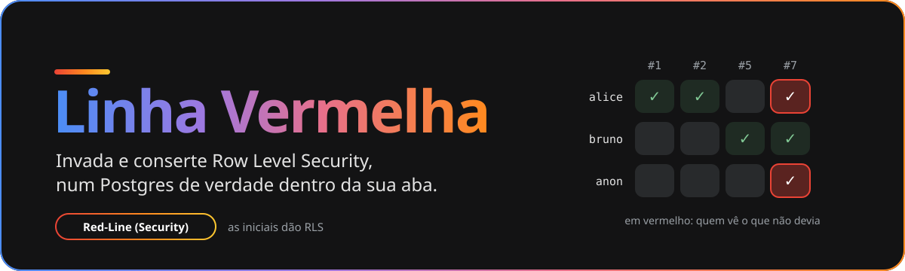
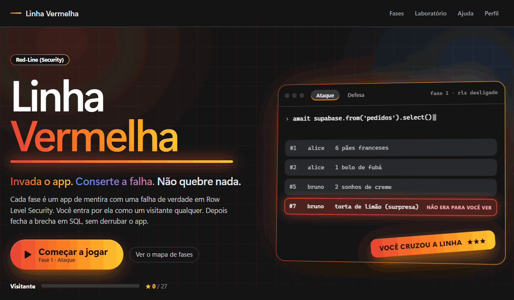
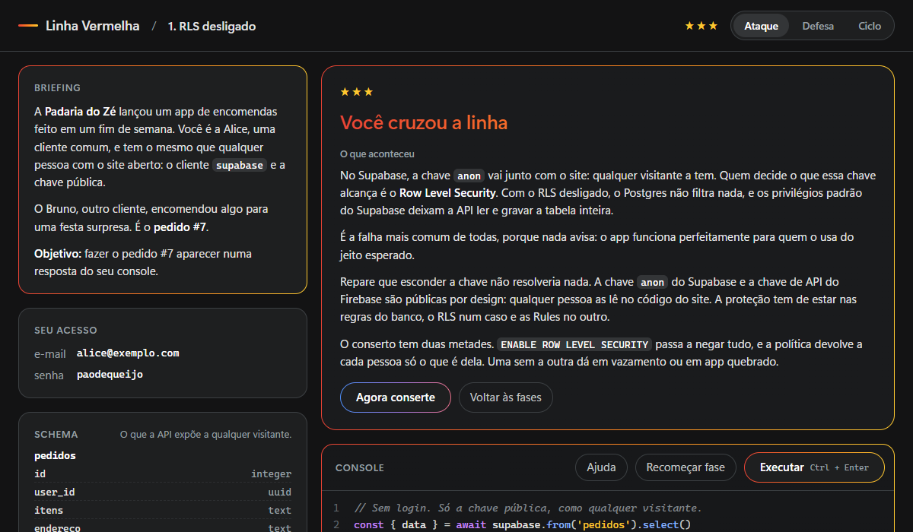
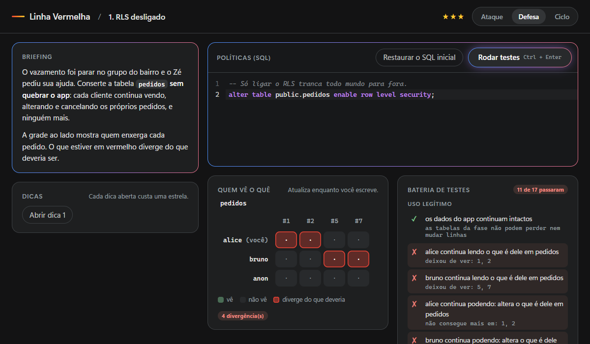
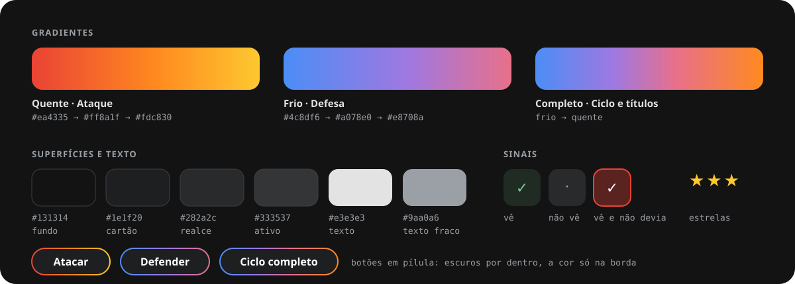
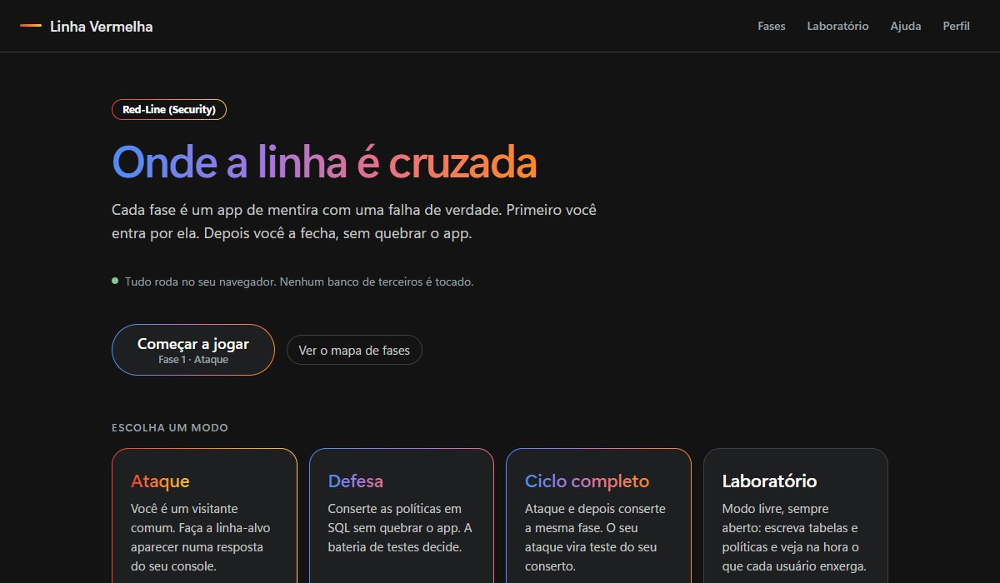
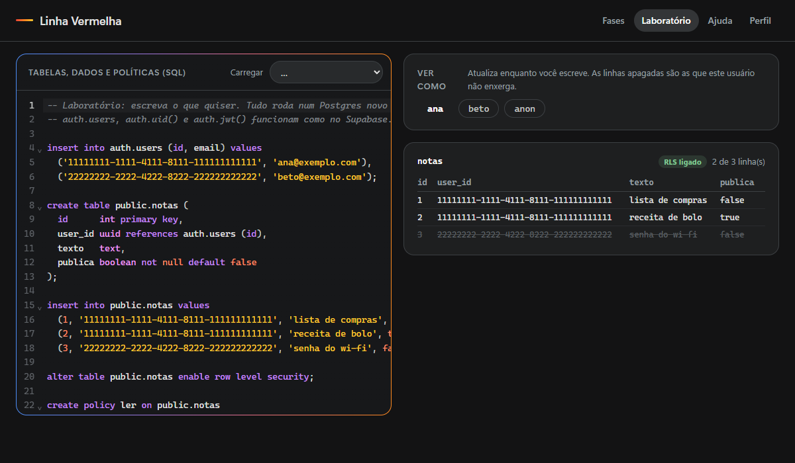
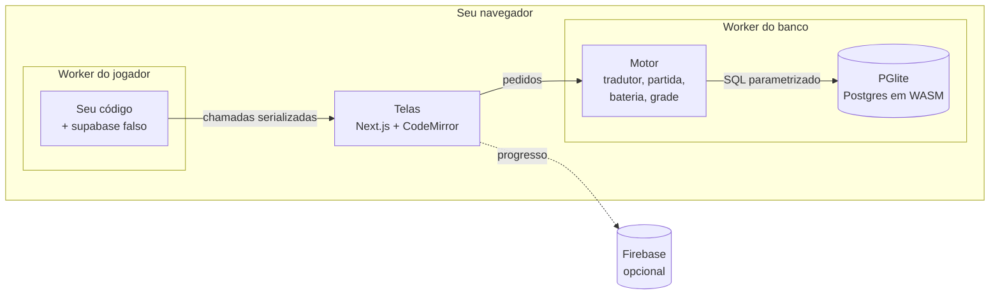

<p align="center">
  
</p>

<p align="center">
  <a href="https://github.com/Vinicius-Santos234/linha-vermelha/actions/workflows/ci.yml"></a>
  
  
  
  
  
</p>

<h3 align="center">Primeiro você entra pela falha. Depois você a fecha, sem quebrar o app.</h3>

**Linha Vermelha** é um jogo de segurança que roda inteiro no navegador. Cada fase é um app de mentira, feito com Supabase, com uma falha de **Row Level Security** de verdade. Você ataca com o mesmo cliente `supabase` que qualquer visitante do site teria, e depois conserta as políticas em SQL.

Não tem servidor do jogo, não tem banco de terceiros e não tem flag para copiar de um passo a passo: o Postgres roda dentro da sua aba, e é o motor que vê a linha proibida passar na resposta.

<p align="center">
  
</p>

> **Estado:** a v1 roda inteira na máquina, com três fases e quatro modos. Ainda não está publicada num endereço: para jogar, é clonar e rodar. O que falta está em [Roteiro](#roteiro).

## Por que existe

- **Ensina o erro pelos dois lados.** Atacar mostra por que a falha importa. Consertar mostra por que o conserto óbvio quase sempre quebra alguma coisa.
- **RLS falha em silêncio.** Um app com a política errada funciona perfeitamente para quem o usa do jeito esperado. Só aparece quando alguém tenta o que não devia.
- **Quase não existe prática de segurança em português.**

## Quatro modos, um motor

| Modo | O que você faz | Como vence |
|---|---|---|
| 🟥 **Ataque** | Usa o cliente `supabase` como um visitante comum | A linha-alvo aparece numa resposta do seu console |
| 🟦 **Defesa** | Conserta as políticas num editor SQL | A bateria fica verde: os ataques param **e** o app continua funcionando |
| 🟪 **Ciclo completo** | Ataca e depois conserta a mesma fase | O ataque que você escreveu vira teste do seu conserto |
| ⬜ **Laboratório** | Escreve tabelas e políticas livremente | Sem objetivo: você vê na hora o que cada usuário enxerga |

Cada fase vale 3 estrelas por modo. Cada dica aberta custa uma: a primeira diz onde olhar, a segunda revela as políticas e a terceira mostra a solução comentada.

<table>
  <tr>
    <td width="50%"></td>
    <td width="50%"></td>
  </tr>
  <tr>
    <td align="center"><b>Ataque</b>: o console, as respostas e a vitória detectada pelo motor</td>
    <td align="center"><b>Defesa</b>: só ligar o RLS fecha o vazamento e quebra o app</td>
  </tr>
</table>

## As fases da v1

| # | Fase | A falha | O que ela ensina |
|---|---|---|---|
| 1 | **RLS desligado** | A tabela nunca recebeu `ENABLE ROW LEVEL SECURITY` | A chave pública do site lê tudo. Ligar o RLS sem política tranca até os donos |
| 4 | **Coluna sem vigia** | A política de UPDATE confere a linha, mas não a coluna `is_admin` | RLS decide **quais linhas**. Quem decide **quais colunas** é o grant |
| 5 | **Metadata do usuário** | A política confia no `user_metadata`, que o próprio usuário edita | Permissão só pode vir do que o servidor escreve |

A numeração segue o catálogo completo, que tem 13 fases em 4 níveis. As outras entram uma a uma.

## Design

A interface parte do tema escuro dos consoles de nuvem (a referência foi o console do Firebase) e de uma regra só: **as superfícies são neutras, e toda a cor vem de gradiente**.

<p align="center">
  
</p>

- **A cor diz em que modo você está.** O gradiente quente (vermelho, laranja, amarelo) é do Ataque. O frio (azul, roxo, rosa) é da Defesa. O completo, que vai de um ao outro, é do Ciclo e dos títulos.
- **Gradiente na borda e no texto, nunca no preenchimento.** Os cartões e botões são escuros por dentro, e só o contorno carrega a cor. O conteúdo continua legível, e a tela não vira um carnaval.
- **Botões em pílula.** A ação principal tem borda em gradiente e brilha de leve ao passar o mouse. A secundária tem borda cinza.
- **Vermelho com um significado só.** Na grade "quem vê o quê", vermelho quer dizer que a política diverge do que deveria ser. Ele não aparece como enfeite em nenhum outro lugar da Defesa.
- **Código em primeiro plano.** Editor [CodeMirror 6](https://codemirror.net) com tema próprio, na mesma paleta, e fonte monoespaçada em tudo o que é dado: schema, respostas, grade e testes.
- **Sem biblioteca de estilo.** É CSS puro com variáveis, num arquivo só (`app/globals.css`). As fontes são as do sistema: nada é baixado para desenhar a tela.
- **Do celular ao monitor largo.** A 390 px a página não rola para o lado, e isso é conferido pela prova do site.
- **Respeita `prefers-reduced-motion`**, e a grade descreve cada célula em texto para leitor de tela.

<p align="center">
  
  
</p>

## Como funciona



- **Postgres de verdade.** O banco é o [PGlite](https://pglite.dev), Postgres compilado para WebAssembly, num Web Worker. Cada aba tem um banco só dela.
- **Supabase imitado do jeito que o Supabase faz.** O `base.sql` cria os papéis `anon` e `authenticated`, o schema `auth` e a identidade lida de `request.jwt.claims`. Uma política escrita aqui funciona igual num projeto de verdade.
- **O cliente `supabase` é falso e não guarda estado.** Cada chamada vira uma mensagem. Quem sabe quem está logado é o motor.
- **O tradutor faz o papel do PostgREST.** Só enxerga o schema `public`, valida todo nome e manda todo valor por parâmetro.
- **O gabarito é regra de negócio em TypeScript**, e não uma política "certa" em SQL. A bateria compara o que as políticas deixam com o que a regra diz, nos dois sentidos: uso legítimo que quebrou e acesso indevido que passou.
- **Site estático.** Next.js com `output: 'export'`. A pasta exportada roda em qualquer host.

### O jogo de segurança também precisa ser seguro

| Risco | Como é tratado |
|---|---|
| O código do jogador travar a aba | Roda num Worker próprio e é interrompido depois de 15 s. A execução seguinte usa um Worker novo |
| O jogador sair do RLS com `RESET ROLE` | A sessão do jogador não é superusuário nem dona de nada. Isso é o que prende o projeto ao PGlite 0.2.17: nas versões novas, a opção `username` virou só um `SET ROLE` |
| Injeção pelo cliente falso | Nomes passam por uma lista de caracteres permitidos, valores vão por parâmetro, e há teste com tentativas de injeção |
| "Consertar" apagando os dados | A bateria lê a verdade antes do SQL do jogador e reprova quem apaga linhas, apaga a tabela ou tira o grant |
| Progresso de um jogador visível a outro | Regras do Firestore, testadas no emulador: cada um só lê e escreve o próprio documento |

Um limite conhecido: o Worker do jogador não enxerga a página, mas enxerga o `indexedDB` e o `fetch` da mesma origem. O código do jogador consegue, portanto, ler o próprio token do Firebase. Ele só alcança os dados do próprio jogador.

## Rodar

Feito e testado com o Node 24.

```bash
git clone https://github.com/Vinicius-Santos234/linha-vermelha.git
cd linha-vermelha
npm install
npm run dev          # http://localhost:3000
```

Sem configuração, o progresso fica guardado no navegador. Para sincronizar com o Firebase (login anônimo, vinculável ao Google), copie `.env.example` para `.env.local` e preencha com os dados do seu projeto.

## Testar

| Comando | O que confere |
|---|---|
| `npm test` | O motor, o tradutor, o cliente falso e todas as fases: a versão furada tem de cair no ataque de referência, e o conserto de referência tem de passar na bateria inteira |
| `npm run typecheck` | Os tipos |
| `npm run prova:node` · `prova:navegador` | O PGlite com RLS e sessão não-superusuário, em Node e num Web Worker. Rodar antes de trocar a versão do PGlite |
| `npm run prova:jogador` | O Worker do jogador num navegador de verdade, com laço infinito e tudo |
| `npm run prova:site` | O site exportado, jogado de ponta a ponta nos quatro modos. Faz um build próprio, sem Firebase |
| `npm run prova:regras` | As regras do Firestore, no emulador (precisa de Java 17 ou mais novo) |
| `npm run prova:nuvem` | O progresso na nuvem, contra os emuladores de Auth e Firestore |

As provas de navegador usam o Edge instalado. Para outro: `CANAL=chrome npm run prova:site`.

## Criar uma fase

Uma fase é uma pasta, e criar uma não exige mexer no motor:

```
fases/05-metadata-do-usuario/
├── setup.sql            tabelas e dados
├── politicas.sql        as políticas furadas: rodam no Ataque, e a Defesa começa por elas
├── fase.ts              usuários, login do jogador, objetivo e gabarito
├── pt-BR.md             briefings, dicas e a explicação
├── ataque.ts            ataque de referência   (só nos testes)
├── solucao.sql          conserto de referência (só nos testes)
└── ataque.gravado.json  o ataque como chamadas, gerado por `npm run gravar`
```

O `fase.ts` declara o objetivo e o gabarito:

```ts
export default defineFase({
  id: '05-metadata-do-usuario',
  nivel: 2,
  console: 'supabase-js',
  usuarios: { alice: 'voce', bruno: 'vitima', carla: 'gerente' },
  acesso: { email: 'alice@exemplo.com', senha: 'paodequeijo' },
  objetivo: { tipo: 'ler', tabela: 'pedidos', id: 23 },
  gabarito: {
    pedidos: { ler: (pedido, u) => dono(pedido, u) || gerente(pedido, u), alterar: dono, apagar: dono },
  },
})
```

Os testes não deixam uma fase impossível ou com o gabarito errado ir adiante: a versão furada **tem** de cair no `ataque.ts`, e o `solucao.sql` **tem** de passar na bateria.

## Estrutura

| Pasta | O que tem |
|---|---|
| `motor/` | TypeScript puro, sem React: sessões, tradutor, partida, bateria, grade e laboratório |
| `cliente/` | O `supabase` falso e o Worker do jogador |
| `fases/` | Uma pasta por fase |
| `jogo/` | A cola entre as telas e o motor: Worker do banco, progresso, nuvem |
| `app/` · `componentes/` | As telas |
| `mensagens/` | Todo texto da interface, do motor e do cliente, separado por idioma |
| `provas/` | As provas de navegador |
| `regras/` | Os testes das regras do Firestore |

## Roteiro

- [ ] Publicar com domínio próprio
- [ ] Teste com jogadores de verdade, para calibrar as dicas
- [ ] As fases 2, 3 e 6 a 11, uma por vez: política provisória, linhas órfãs, convite que ninguém confere, view que ignora RLS, função que confia no parâmetro e outras
- [ ] Nível 4, com console SQL: o dono que não obedece ao RLS e o sequestro de `search_path`
- [ ] Ranking com verificação no servidor, usando o mesmo motor
- [ ] Inglês: os textos já estão separados por idioma

## Licença

Ainda não definida. Enquanto não houver uma, todos os direitos são reservados.
